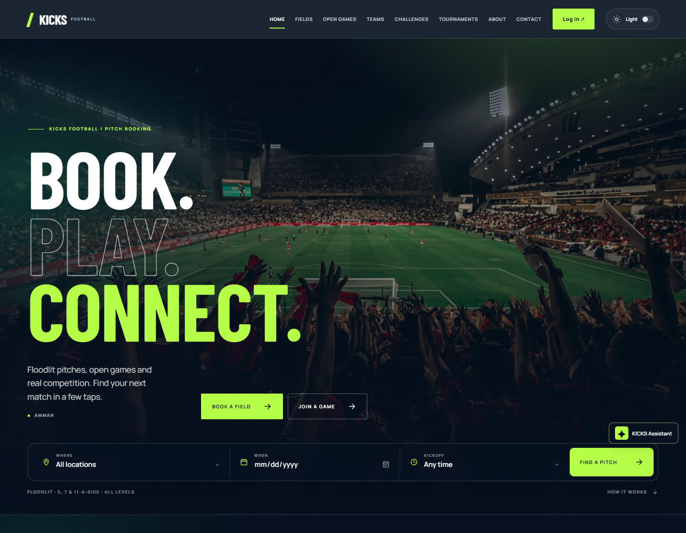
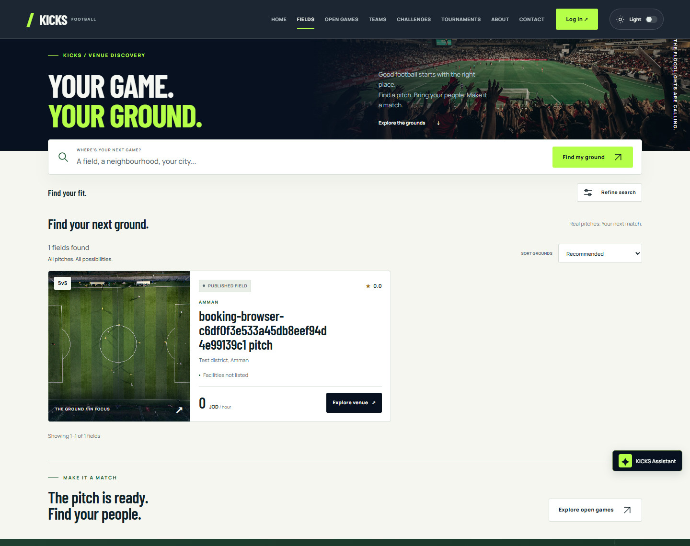
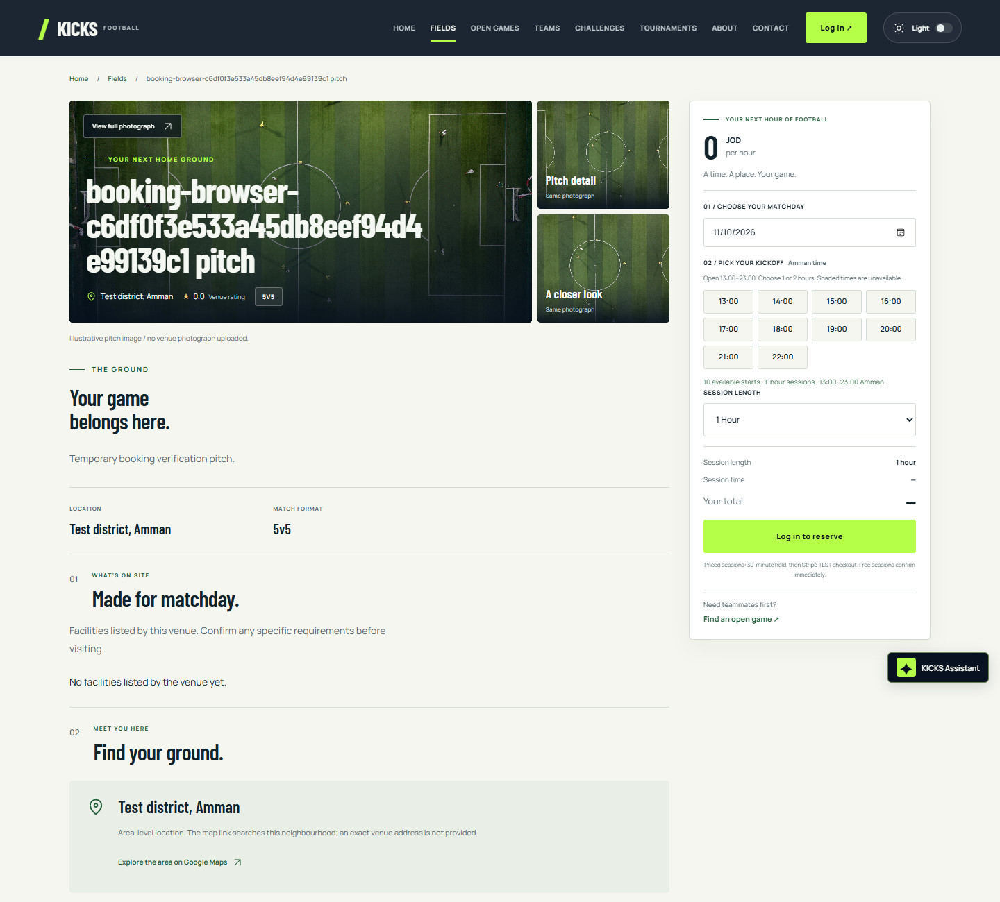
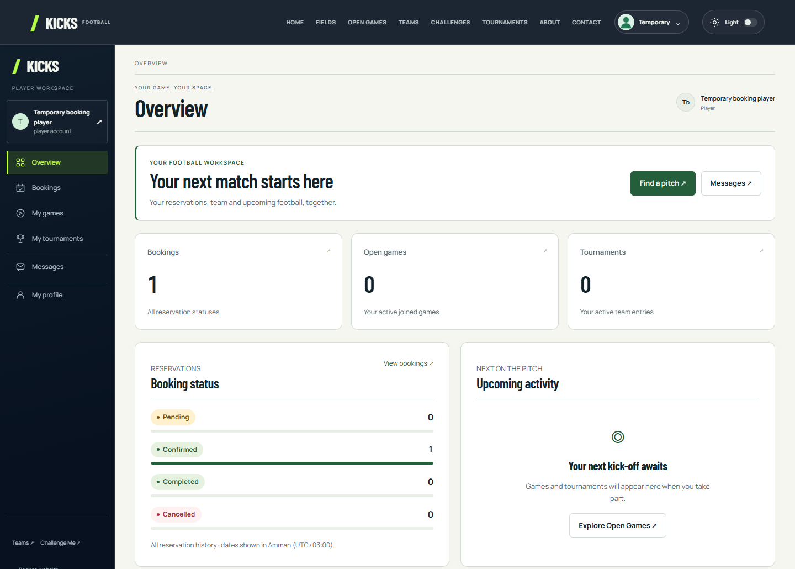
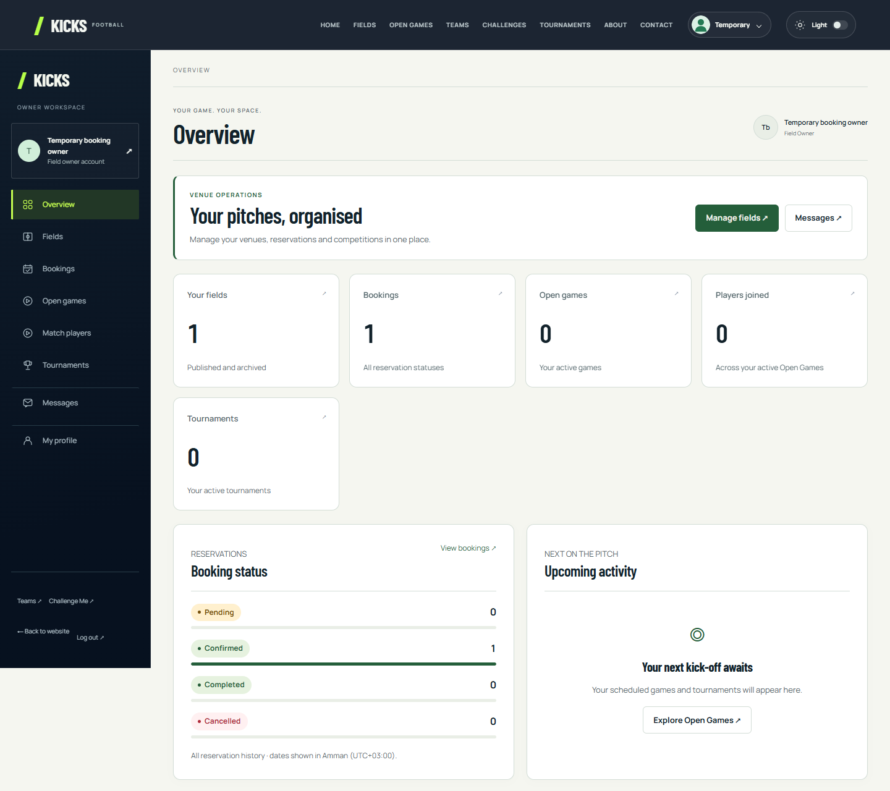
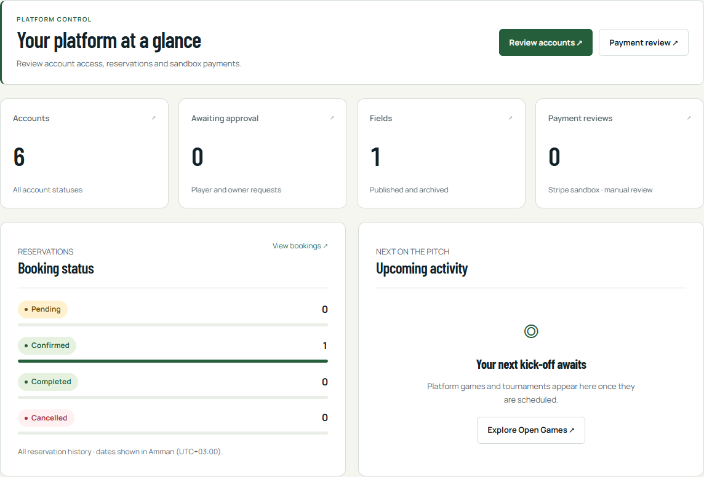
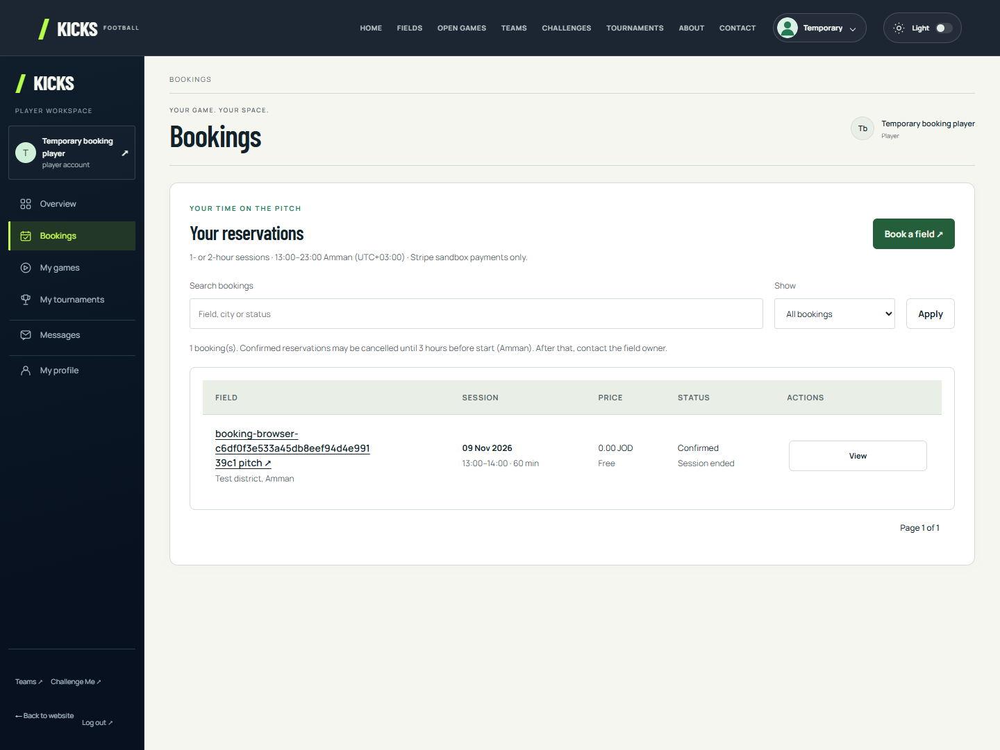
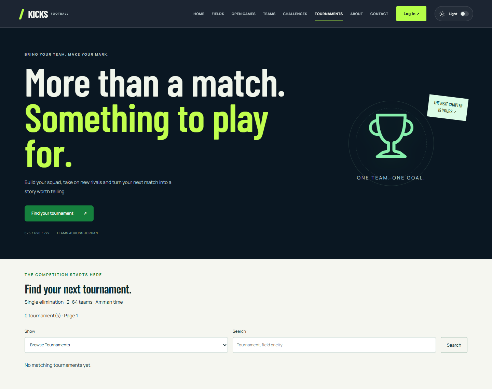
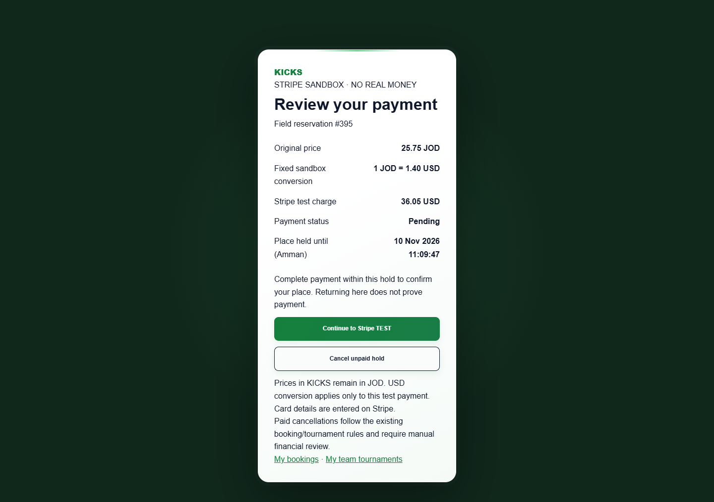
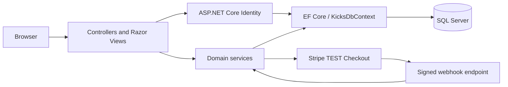

<div align="center">

<h1>KICKS</h1>
<p><strong>Football Field Booking &amp; Sports Management Platform</strong></p>
<p>Book. Play. Connect.</p>

<p>A football workspace connecting players, field owners, and administrators—from finding a pitch to organizing the next competition.</p>

<p>
  
  
  
  
  
</p>

<p>
  <a href="#overview">Overview</a> ·
  <a href="#features">Features</a> ·
  <a href="#screenshots">Screenshots</a> ·
  <a href="#architecture">Architecture</a> ·
  <a href="#local-setup">Local setup</a> ·
  <a href="#testing-and-quality">Verification</a>
</p>

</div>

[](docs/screenshots/home.jpg)

<p align="center"><sub>Actual application capture · Microsoft Edge · Phase 8 final verification</sub></p>

## Overview

KICKS brings the practical work of community football into one ASP.NET Core MVC application. Players discover fields, reserve time, build squads, join Open Games, challenge other teams, and enter tournaments. Field owners manage venues, reservations, participation, schedules, and results. Administrators review account access, ownership documents, platform activity, feedback, and sandbox payment history.

The implemented workflows use SQL Server persistence, ASP.NET Core Identity, and server-side business rules. A shared availability check coordinates bookings, Open Games, and tournament matches so competing reservations cannot claim the same field time. Stripe-hosted **test** checkout supports priced bookings, team challenges, and tournament entries.

## Features

### Player

- **Account access:** register as a player and sign in after administrator approval; view the Identity-backed account profile.
- **Field discovery:** search and filter the catalogue by location, format, price, and rating; inspect images, amenities, and available sessions.
- **Bookings:** reserve one- or two-hour sessions, review statuses and history, and cancel eligible reservations.
- **Teams:** create a squad, browse profiles, request membership, and manage requests. Captains edit their team, review members, and transfer leadership.
- **Open Games:** join available owner-organized games directly and leave before the participation cutoff.
- **Challenges:** captains send and respond to team proposals, with a field reservation when one is included and confirmed.
- **Tournaments:** captains register eligible teams for free or paid single-elimination competitions and follow fixtures and results.
- **Payments and messages:** review JOD/USD amounts before Stripe TEST checkout and exchange SQL-persisted messages with authorized contacts.

### Field owner

- **Venues:** publish and edit fields, upload a field photograph, select amenities, and archive or restore listings while retaining history.
- **Reservations:** manage own-field bookings, cancel future reservations, complete ended sessions, and inspect payment/review status.
- **Open Games:** create games, manage permitted details and capacity, inspect joined players, and cancel upcoming games.
- **Competitions:** create tournaments for **2–64 teams**, generate knockout draws and byes, schedule individual matches, and finalize scores or shootouts to advance winners.
- **Dashboard:** view SQL-derived field, booking, game, participation, and tournament totals, recent reservations, and upcoming activity.

### Administrator

- **Account review:** search and filter registrations, approve or reject access, and deactivate eligible accounts.
- **Ownership verification:** review private uploaded documents through administrator-only downloads.
- **Oversight:** inspect searchable, paginated field and booking records.
- **Financial review:** inspect SQL-backed sandbox payment history and records flagged for manual review.
- **Platform presentation:** review submitted feedback and update the site's title, description, city, and contact presentation.

## Screenshots

The home image above and gallery below come from existing browser evidence. Fixture names and empty states reflect the recorded test environment. Images are cropped for focus; the administrator image shows aggregate dashboard panels with account identity and reservation records excluded. Select any image to inspect it at full size.

<table>
  <tr>
    <th width="50%">Field discovery</th>
    <th width="50%">Field details &amp; availability</th>
  </tr>
  <tr>
    <td><a href="docs/screenshots/field-discovery.jpg"></a></td>
    <td><a href="docs/screenshots/field-details.jpg"></a></td>
  </tr>
  <tr>
    <th>Player dashboard</th>
    <th>Field owner dashboard</th>
  </tr>
  <tr>
    <td><a href="docs/screenshots/player-dashboard.png"></a></td>
    <td><a href="docs/screenshots/owner-dashboard.png"></a></td>
  </tr>
  <tr>
    <th>Administrator overview</th>
    <th>Booking management</th>
  </tr>
  <tr>
    <td><a href="docs/screenshots/admin-dashboard.png"></a></td>
    <td><a href="docs/screenshots/bookings.png"></a></td>
  </tr>
  <tr>
    <th>Tournament discovery</th>
    <th>Stripe test payment review</th>
  </tr>
  <tr>
    <td><a href="docs/screenshots/tournaments.png"></a></td>
    <td><a href="docs/screenshots/stripe-test-review.png"></a></td>
  </tr>
</table>

See the [public screenshot provenance](docs/screenshots/README.md) for sources and crops, or the [Phase 8 screenshot index](docs/phase8/SCREENSHOTS.md) for the original local evidence inventory.

## Technology stack

| Layer | Implementation |
| --- | --- |
| Backend | C#, **.NET 10**, ASP.NET Core MVC |
| Data access | Entity Framework Core **10.0.14**, Code First mappings and migrations |
| Database | Microsoft SQL Server |
| Authentication | ASP.NET Core Identity, integer-key users, cookies, account approval, and role-based authorization |
| Frontend | Razor Views, HTML5, CSS3, JavaScript, Bootstrap **5.3.8**, and custom responsive layouts |
| Payments | Stripe-hosted Checkout, official **Stripe.net 53.1.0**, signed webhooks, TEST mode only |

## Architecture

KICKS uses the MVC pattern with focused service classes. Controllers handle routes and authorization; services enforce booking, membership, competition, and payment rules. Validated ViewModels carry form input and presentation data, while EF Core maps domain and Identity entities to SQL Server. Razor renders pages and partials; JavaScript calls MVC endpoints for interactive workflows.



Identity roles (`player`, `owner`, `admin`) and active-account checks control access. Resource checks restrict owners to their own venues and players to their permitted actions. SQL transactions, constraints, protected quotes, and a shared field occupancy gate protect prices, capacity, and overlapping sessions. State-changing forms use anti-forgery validation; the Stripe webhook uses signature verification.

<details>
<summary><strong>Explore the repository structure</strong></summary>

```text
KicksMvc/
├── Controllers/             MVC pages, API actions, and role boundaries
├── Services/                Authentication, fields, bookings, teams,
│                           activities, tournaments, payments, workspaces
├── Models/                  Domain entities, Identity roles, legacy mapping
├── ViewModels/              Validated inputs and presentation models
├── Data/                    KicksDbContext, mappings, and EF migrations
├── Views/                   Razor pages and shared partials
├── wwwroot/                 Styles, scripts, images, fonts, and vendor assets
├── tests/                   SQL/API integration and browser suites
├── scripts/                 Verification and explicit local setup helpers
└── docs/                    Backend reports, Phase 8 evidence, screenshots
```

The [route inventory](docs/phase8/ROUTE-INVENTORY.md) documents the implemented endpoints, authorization, Razor views, and dashboard sections.

</details>

## Main workflows

| Workflow | From intent to outcome |
| --- | --- |
| Book a field | Find a venue → choose an available 60/120-minute session → review the server-calculated price → confirm free sessions immediately or complete payment within a 30-minute hold. |
| Manage a venue | Approved owner publishes a field with its price, photograph, and amenities → manages reservations and activities → archives or restores the listing when needed. |
| Captain a team | Player creates a team → reviews membership requests → manages the roster or transfers captaincy. Each player can belong to one team. |
| Accept a challenge | Captains exchange a proposal → acceptance rechecks eligibility and availability → a free field confirms immediately; a priced field requires the challenging captain's full sandbox payment. Fieldless acceptance records an agreement without reserving a pitch. |
| Run a tournament | Owner creates a single-elimination event → captains register teams with frozen rosters → owner generates the draw and schedules matches → finalized results advance winners through to the champion. Only scheduled matches reserve field time. |
| Confirm a payment | Payer reviews JOD and USD amounts → pays on Stripe TEST Checkout → KICKS verifies signed webhook events and provider/SQL details → the reservation or entry is confirmed. Returning from Checkout alone cannot confirm it. |

Sessions start on full hours within **13:00–23:00 Amman time (UTC+03:00)**. Player cancellation of confirmed bookings requires at least **three hours** before kickoff; leaving an Open Game requires at least **one hour**.

## Database overview

The Phase 8 verified SQL Server schema contains **38 physical tables and 80 foreign keys**: 27 domain tables, three Stripe sandbox tables, six Identity support tables, the retained legacy `meetings` table, and EF migration history. The domain count includes `dbo.users`, which is also the Identity user table.

| Area | Main relationships |
| --- | --- |
| Accounts & venues | Users own fields and ownership documents; fields link to images and amenities. |
| Reservations | Bookings connect a player, field, and owner; team snapshots preserve historical booking participation. |
| Teams & participation | Teams connect captains, members, recruitment positions, and membership requests; Open Games connect fields and participants. |
| Challenges & competitions | Challenges connect teams and proposals; tournaments connect team registrations, roster snapshots, draw entries, matches, and match slots. |
| Payments & workspace | `gateway_payments` links payers to bookings or tournament entries; `stripe_checkout_attempts` and `stripe_webhook_events` retain processing history. Messages, feedback, and site settings also persist in SQL. |

The [EF context](Data/KicksDbContext.cs) and [migrations](Data/Migrations) are authoritative. The earlier SQL export and browser schema explorer are historical references. Uploaded files live under `App_Data` with SQL metadata; ownership proofs have private, administrator-only access. Database backups and corresponding uploaded files should be preserved together.

## Testing and quality

The completed **Phase 8 verification, recorded on 10 November 2026**, reports:

| Verification gate | Recorded result |
| --- | --- |
| Acceptance assertions | **1,322 passed · 0 failed · 0 skipped** |
| Debug and Release builds | Successful, **0 warnings / 0 errors** |
| SQL/API and isolation checks | 733 SQL/API assertions + 20 isolation guard assertions |
| Real Microsoft Edge testing | 569 assertions across role workflows, pages, and responsive checks |
| Stripe TEST regression | Actual hosted Checkout and signed events; 77 SQL/API + 39 Edge assertions, included above |
| Responsive layout matrix | **1440px · 768px · 390px · 320px** |
| Preservation | Isolated restored-database tests, original database/file fingerprints, and integrity checks |

Read the [Phase 8 final report](docs/phase8/FINAL-REPORT.md) for the complete counts, executed checks, limitations, and preservation evidence. These are recorded local acceptance results, not production, penetration-test, or accessibility certification.

## Local setup

### 1. Prerequisites

- Windows with the **.NET 10 SDK**; Visual Studio with .NET 10/ASP.NET support is optional.
- SQL Server reachable as `localhost`, with Windows Authentication and access to a reviewed KICKS database.
- A checkout of the MVC implementation containing `KicksMvc.csproj`. The completed local branch is `feature/final-testing-ui-polish`; unpublished local work may not yet be available from the remote repository.
- For optional payments: PowerShell **7+**, a Stripe test-mode account, and the official Stripe CLI available on `PATH`.

Open PowerShell in the directory containing the project file:

```powershell
dotnet restore
dotnet tool restore
```

The repository pins `dotnet-ef` **10.0.14** in its root tool manifest.

### 2. Prepare the database

**Database preparation is a separate prerequisite.** This checkout was built against an inspected existing schema and its reviewed migration history. It does not include a verified, portable one-command database bootstrap or a demo-account/venue seed workflow. A fresh clone alone is not a populated, runnable demo.

Use an authorized local restore matching the current migrations, or review a fresh-database provisioning plan before applying them. Read the [database setup report](docs/backend/DATABASE-SETUP-COMPLETE.md) and [database artifact guidance](database/README.md) first; the [Stripe report](docs/backend/STRIPE-SANDBOX-COMPLETE.md) describes the latest schema additions. The machine-specific baseline-adoption script and historical `KICKS-schema.sql` must not be rerun against an existing upgraded database. Ordinary application startup never creates the database, applies migrations, or creates accounts.

### 3. Configure and run

For the reviewed local database named `Kicks`, set a Windows-authenticated connection in the current terminal. This example contains no password:

```powershell
$env:ASPNETCORE_ENVIRONMENT = 'Development'
$env:ConnectionStrings__DefaultConnection = 'Server=localhost;Database=Kicks;Integrated Security=True;TrustServerCertificate=True'
dotnet run --project KicksMvc.csproj --launch-profile KicksMvc
```

Open [http://127.0.0.1:5602/index.html](http://127.0.0.1:5602/index.html). Alternatively, open `KicksMvc.sln` in Visual Studio and run the **KicksMvc** profile with the equivalent local configuration. `appsettings.Development.json` is ignored by Git and can hold the local connection setting; keep secrets outside tracked files.

New player and owner registrations require administrator approval. Historical browser demo credentials do not sign in to MVC. An empty field catalogue is expected until an approved owner publishes a venue.

<details>
<summary><strong>Explicit initialization for a newly reviewed local environment</strong></summary>

After schema preparation, the idempotent amenities command adds the six implemented reference choices:

```powershell
dotnet run --project KicksMvc.csproj --launch-profile KicksMvc -- --initialize-field-amenities
```

If the database has no administrator, the Development-only interactive command provisions the first one, using hidden password input and an explicit confirmation. It refuses to create another when an administrator already exists:

```powershell
dotnet run --project KicksMvc.csproj --launch-profile KicksMvc -- --provision-admin
```

See the [authentication report](docs/backend/AUTHENTICATION-COMPLETE.md) before provisioning. These are explicit setup operations, not actions performed by normal startup.

</details>

### 4. Optional Stripe TEST checkout

Paid flows require valid test credentials **and a running webhook listener**. The tracked settings enable sandbox-only processing, set the approved `1.40` conversion, and use `http://127.0.0.1:5602` as the local return origin.

In a separate interactive PowerShell 7+ terminal at the project root, run the existing hidden-input helper to save both test keys to .NET User Secrets:

```powershell
pwsh -File scripts/setup-stripe-test-secrets.ps1
```

Build Release, then start the Development listener from that same project directory with the database configuration from step 3 available:

```powershell
dotnet build KicksMvc.sln --configuration Release
$env:ASPNETCORE_ENVIRONMENT = 'Development'
dotnet bin/Release/net10.0/KicksMvc.dll --stripe-local-listener
```

Keep this terminal open. Wait for **READY**, then start or restart the MVC application in another terminal using step 3. The wrapper runs the official Stripe CLI, stores its signing secret in User Secrets, and forwards events to `http://127.0.0.1:5602/payments/stripe/webhook`. The normal listener expects Windows-authenticated `localhost/Kicks`. Without verified webhook delivery, returning from Checkout leaves payment unconfirmed.

Follow the [Stripe sandbox report](docs/backend/STRIPE-SANDBOX-COMPLETE.md) for the full listener and verification behavior. Never paste API keys or webhook secrets into source, commands, screenshots, or issue reports.

### Verification without database changes

The model inspection command does not open a database connection:

```powershell
dotnet run --project KicksMvc.csproj --no-launch-profile -- --verify-model
```

Mutating integration/browser suites require `KICKS_TEST_CONNECTION` targeting a separately restored local database named `Kicks_BookingTest_<yyyyMMdd>_<8 lowercase hexadecimal characters>`. They reject the original `Kicks` database; browser suites also require their isolated application URL. Follow the [Phase 8 report](docs/phase8/FINAL-REPORT.md) and suite-specific backend reports before running them.

## Security and payment boundaries

- **Stripe integration uses TEST MODE ONLY. No real money is processed.** Live credentials are rejected by the implemented sandbox checks.
- **JOD is the original pricing currency.** Sandbox checkout uses the approved fixed conversion **1 JOD = 1.40 USD**; this is a test policy, not a market exchange-rate feed.
- **Payment confirmation requires verified Stripe webhooks.** Browser redirects and displayed success messages cannot authorize fulfillment.
- **Automatic refunds and real payouts are not implemented.** Paid cancellations and withdrawals retain payment history and flag manual financial review. That review queue does not execute a refund or settlement.
- Identity approval, current roles, active status, ownership checks, private document access, and server validation protect the implemented workflows. These controls do not imply production security certification.

## Roadmap — Planned / Not Yet Implemented

- Email notifications and email verification.
- Password reset, account recovery, and self-service profile editing.
- Real-time notifications and message delivery updates.
- Interactive booking calendar.
- Tournament group stages.

## Author and repository

Created by **moazzam9444**, as recorded in the repository's commit history.

[GitHub repository](https://github.com/moazzam9444-wq/MVC_Master) · [Phase 8 final report](docs/phase8/FINAL-REPORT.md) · [Route inventory](docs/phase8/ROUTE-INVENTORY.md)
